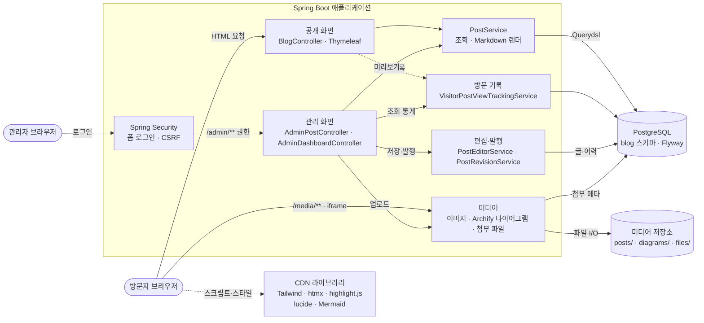

# dean.p

Spring Boot 서버 렌더링 방식으로 만드는 개인 블로그입니다. 별도 프론트엔드 서버 없이 Spring Boot가 HTML과 정적 파일을 함께 제공하고, 글은 외부 PostgreSQL에 저장합니다.

## 기능

- **공개 화면:** 홈, 글 목록(카테고리·시리즈·태그 필터와 페이지), 검색, 글 본문, 소개 화면. 반응형 라이트·다크 테마를 지원합니다. 발행 상태이고 발행 시각이 지난 글만 보입니다.
- **글 관리(`/admin/posts`):** 글 작성·수정, 예약 발행, 삭제·복구, 변경 이력 보기·되돌리기, 대표 이미지, 이미지·Archify 다이어그램·첨부 파일 업로드, 실시간 미리보기를 지원합니다.
- **대시보드(`/admin`):** 로그인하면 처음 보는 화면으로, 상태별 글 수, 예약·최근 고친 글, 최근 30일 조회수·방문자 추이, 많이 본 글, 유입 경로, 검색 유입, 국가를 보여 줍니다.
- **분류 관리:** 카테고리·시리즈·태그를 관리합니다. 시리즈에 글을 배치하고, 태그는 합칠 수 있습니다.
- **보안:** 관리자 로그인은 폼 로그인과 CSRF 보호를 쓰고, 5회 연속 실패하면 15분 동안 잠깁니다. 관리자 계정은 환경변수로 만듭니다.
- **방문 기록:** 글 조회를 익명 쿠키 기준으로 기록하고 일별로 집계합니다. 유입 사이트, 검색 엔진, 접속 국가(Cloudflare `CF-IPCountry`)를 함께 남기며, 로그인한 관리자의 조회는 세지 않습니다.

## 시스템 구조



- 모든 요청은 Spring Security를 거치며, `/admin/**`만 글쓰기 권한이 필요하고 나머지는 공개입니다.
- Archify 다이어그램은 `/media/diagrams/{id}`에서 CSP sandbox로 격리해 내보내고, 그 밖의 응답은 iframe 삽입을 막습니다(`X-Frame-Options: DENY`).
- 첨부 파일은 `/media/files/{id}`에서 다운로드로만 내보냅니다. 공개 글의 파일은 누구나, 공개 전·삭제한 글의 파일은 로그인한 작성자만 받을 수 있습니다.
- 빌드·배포: Jenkins가 통합 테스트와 Playwright E2E를 돌린 뒤 `bootJar`를 만들고, `dev` 브랜치는 개발 서버에 배포합니다. 앱은 Docker(Temurin 25 JRE)로 실행합니다.

## 기술 스택

- Java 25, Spring Boot 4.1.1(Spring MVC·Security·Data JPA), Gradle
- Thymeleaf, Tailwind·htmx·highlight.js·lucide(CDN), Mermaid 12.1.0(필요할 때만 불러옴)
- PostgreSQL(`blog` 스키마), Flyway migration, Querydsl, flexmark(Markdown)
- 테스트: JUnit 5, Testcontainers, Playwright Java(E2E)

## 실행

앱은 PostgreSQL 연결이 필요해서 `dev` 또는 `prod` 프로필로 실행합니다. 프로필 없이 실행하면 DB 설정이 없어 기동하지 않습니다.

```bash
SPRING_PROFILES_ACTIVE=dev ./gradlew bootRun
```

- Gradle toolchain이 Java 25를 사용하므로, 시스템 기본 Java가 Java 25이거나 Gradle이 Java 25 toolchain을 찾을 수 있어야 합니다.
- 환경변수는 루트의 `.env.dev` 또는 `.env.prod`에 두면 해당 프로필이 자동으로 읽습니다. 두 파일은 Git에서 제외되어 있으므로 비밀번호를 커밋하지 않습니다.
- Flyway가 기동할 때 `blog` 스키마 migration을 적용합니다. 운영 DB에 새 migration을 배포하기 전에는 백업합니다.

| 변수 | 설명 |
|---|---|
| `WAS_PORT` | HTTP 포트. 로컬 개발은 `8081`을 사용합니다. |
| `DB_URL`, `DB_USER`, `DB_PASSWORD` | PostgreSQL 연결 정보 |
| `ADMIN_LOGIN_ID`, `ADMIN_PASSWORD` | 관리자 계정. 둘 다 비어 있으면 건너뛰고, 한쪽만 있거나 비밀번호가 10자 미만이면 기동을 멈춥니다. |
| `APP_MEDIA_STORAGE_ROOT` | 이미지·다이어그램·첨부 파일 저장 디렉터리. `dev` 기본값은 `../dean-p-blog-media`입니다. |
| `VISITOR_TRUSTED_PROXIES` | 방문자 IP를 믿고 읽을 프록시 주소(선택) |

브라우저에서 `http://localhost:<WAS_PORT>`를 엽니다. 관리 화면은 `/login`에서 로그인한 뒤 대시보드(`/admin`)로 들어갑니다.

## 글 작성: 코드 블록·Mermaid·Archify

본문은 Markdown입니다. 편집기 위의 넣기 도구와 미리보기를 쓸 수 있습니다.

- 코드 블록: ```` ```java ```` 처럼 언어를 적으면 공개 화면에서 강조하고 복사 버튼을 붙입니다.
- Mermaid: ```` ```mermaid ```` 블록은 브라우저에서 다이어그램으로 그립니다.
- Archify: [Archify](https://github.com/tt-a1i/archify) 스킬(v3.1.0)로 만든 HTML을 글 수정 화면의 ‘다이어그램’에서 올리면 ```` ```archify ```` 블록이 들어가고, 공개 화면에서 격리한 iframe으로 조작할 수 있습니다. 블록 첫 줄 `archify` 뒤에 적은 글은 캡션이 됩니다.
- 첨부 파일: 글 수정 화면의 ‘첨부 파일’에서 PDF·압축 파일·문서(docx·xlsx·pptx·hwp)·텍스트·소스 코드 파일(20MB 이하)을 올리면 본문에 내려받기 링크가 들어가고, 공개 화면의 글 끝에 첨부 파일 목록이 붙습니다. 목록에서 지울 수 있지만 본문 링크는 직접 지워야 합니다.

## 테스트

```bash
./gradlew test
```

DB를 쓰는 테스트는 Testcontainers로 일회용 PostgreSQL을 띄우므로 Docker가 실행 중이어야 합니다.

브라우저 E2E 테스트(`src/test/java/com/deanp/blog/e2e`, `@Tag("e2e")`)는 기본 `test`에서 빠져 있습니다. 실제 서버를 무작위 포트로 띄우고, 일회용 PostgreSQL과 헤드리스 Chromium(Playwright Java)으로 로그인·작성·발행·이력·예약·삭제·복구·분류 관리·코드 블록·Mermaid·Archify 흐름을 확인합니다. 처음 실행할 때 Playwright가 Chromium을 내려받습니다(약 150 MB). 실패한 테스트의 마지막 화면은 `build/reports/e2e/`에 남습니다. 화면이 Tailwind·htmx 등을 외부 CDN에서 불러오므로 인터넷 연결이 필요합니다.

```bash
./gradlew e2eTest
```

Jenkins는 CI 전용 DB로 통합 테스트와 E2E를 모두 돌립니다(`Jenkinsfile`, `Jenkinsfile.dev`).

## 주요 경로

| 경로 | 화면 |
|---|---|
| `/` | 홈 |
| `/posts` | 글 목록(카테고리·시리즈·태그 필터) |
| `/posts/{slug}` | 글 본문 |
| `/search` | 검색 |
| `/about` | 소개 |
| `/login` | 관리자 로그인 |
| `/admin` | 관리 대시보드 |
| `/admin/posts` | 글 관리 |
| `/admin/categories`, `/admin/series`, `/admin/tags` | 분류 관리 |
| `/media/posts/**`, `/media/diagrams/{id}` | 업로드한 이미지·다이어그램 |
| `/media/files/{id}` | 첨부 파일 내려받기(공개 전 글은 작성자만) |

## 문서

- [docs/architecture.md](docs/architecture.md): 구조와 렌더링 방식
- [docs/modules.md](docs/modules.md): 패키지·테이블 배치와 기능별 정책
- [docs/development-server.md](docs/development-server.md): 개발 서버와 Jenkins
- [docs/production.md](docs/production.md): 운영 배포
- [docs/representative-image.md](docs/representative-image.md), [docs/visitor-tracking-plan.md](docs/visitor-tracking-plan.md): 기능별 설계

## 디자인 원칙

- 글 본문 폭을 약 740px로 제한해 읽기에 집중합니다.
- 넓은 여백, 부드러운 강조색, 정돈된 카드 리듬을 사용합니다.
- 다크 모드는 순수 검정 대신 따뜻한 차콜 배경을 사용합니다.
- 별도 프론트엔드 서버 없이 Spring Boot가 완성된 HTML과 정적 자산을 제공합니다.
